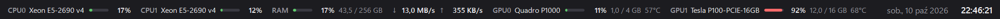

# SysBar

Cienki pasek systemowy dla Windows w stylu doku PowerToys — pokazuje tylko to, co potrzebne: obciążenie CPU, RAM, sieć, GPU i zegar.



## Co pokazuje

- **CPU** — obciążenie z nazwą procesora. Przy kilku procesorach (kilka gniazd) każdy ma osobną pozycję: CPU0, CPU1…
- **RAM** — procent oraz zajęta / całkowita pamięć w GB.
- **Sieć** — prędkość pobierania ↓ i wysyłania ↑ (karty wirtualne i VPN są pomijane, żeby nie liczyć ruchu podwójnie).
- **GPU** — obciążenie z nazwą karty. Przy kilku kartach: GPU0, GPU1…
  - NVIDIA: przez `nvidia-smi`, dodatkowo pamięć i temperatura (działa też dla kart bez wyjścia obrazu, np. Tesla).
  - AMD / Intel: przez liczniki wydajności Windows, samo obciążenie.
- **Zegar** — data i godzina z sekundami.

## Jak działa

- Pasek dokuje się do górnej lub dolnej krawędzi ekranu i rezerwuje tam miejsce, więc zmaksymalizowane okna go nie zasłaniają.
- Jeden pasek na każdym monitorze; po podłączeniu lub odłączeniu monitora paski dodają się i usuwają same.
- Obsługuje monitory o różnym skalowaniu (DPI).
- Chowa się pod aplikacje pełnoekranowe.
- Prawy przycisk myszy na pasku: góra / dół ekranu, „Uruchamiaj z Windows”, „Zamknij”.

## Instalacja

Pobierz `SysBarSetup.exe` z zakładki [Releases](../../releases) i uruchom.

- Instaluje dla bieżącego użytkownika do `%LOCALAPPDATA%\Programs\SysBar`, bez uprawnień administratora.
- Pyta o start razem z Windows, dodaje skrót w menu Start i wpis w „Aplikacje” (odinstalowanie).
- Plik nie jest podpisany cyfrowo — SmartScreen może pokazać ostrzeżenie („Więcej informacji” → „Uruchom mimo to”).

Tryb bez okienek:

```
SysBarSetup.exe /silent /autostart
SysBarSetup.exe /uninstall /silent
```

Można też użyć samego `SysBar.exe` — to pojedynczy plik, nie wymaga instalacji.

## Wymagania

- Windows 10 (1903 lub nowszy) albo Windows 11, 64-bit.
- .NET Framework 4.8 — wbudowany w system.

## Kompilacja

Nie trzeba nic instalować — `build.cmd` używa kompilatora `csc.exe` dostarczanego z .NET Framework:

```
build.cmd
```

Powstają `SysBar.exe` (program) i `SysBarSetup.exe` (instalator z wbudowanym programem).

| Plik | Opis |
| --- | --- |
| `SysBar.cs` | cały program (WPF, jeden plik) |
| `Setup.cs` | instalator / deinstalator |
| `app.manifest` | manifest DPI (PerMonitorV2) |
| `build.cmd` | kompilacja obu plików exe |
